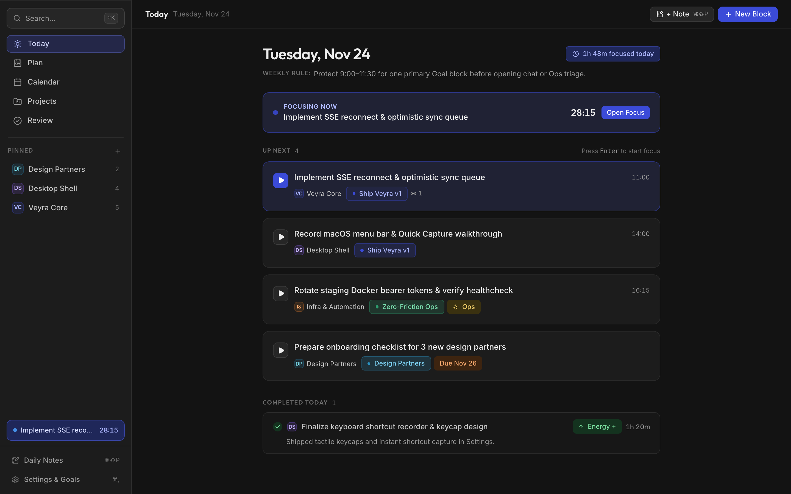
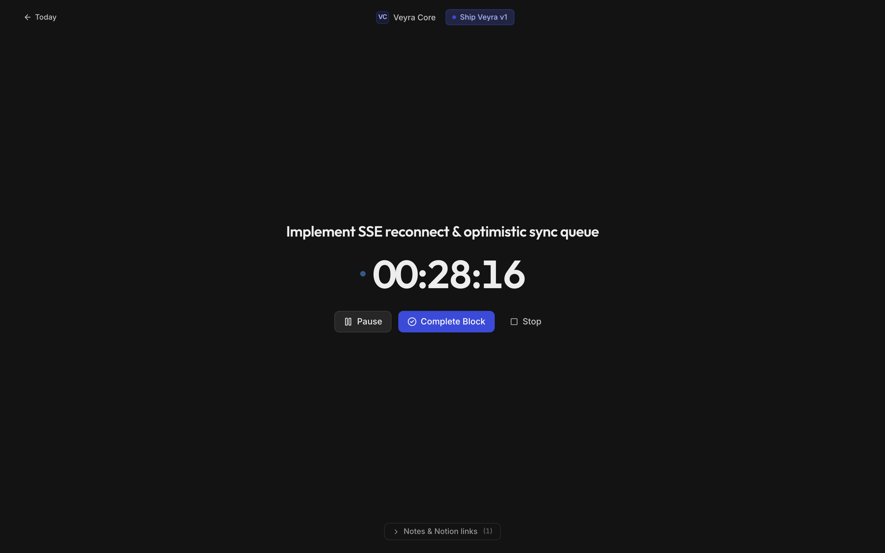
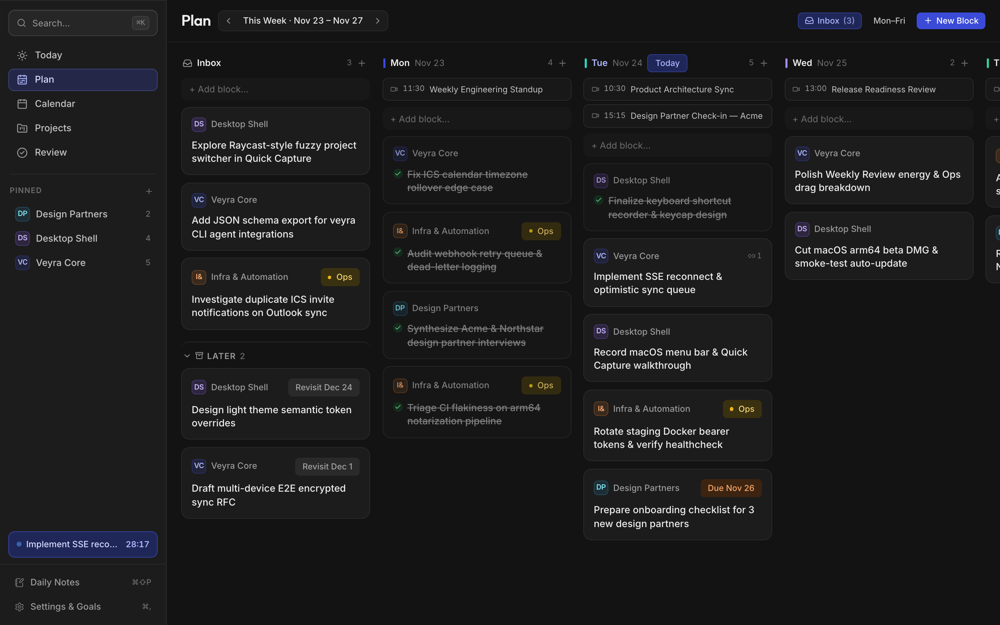
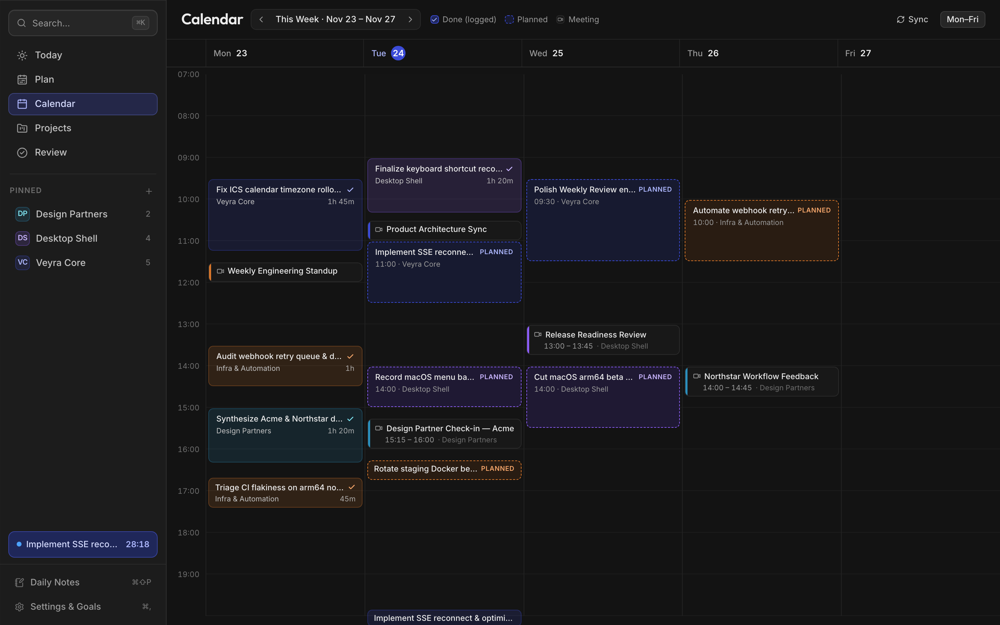
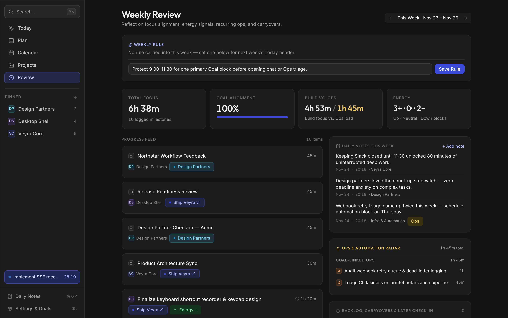
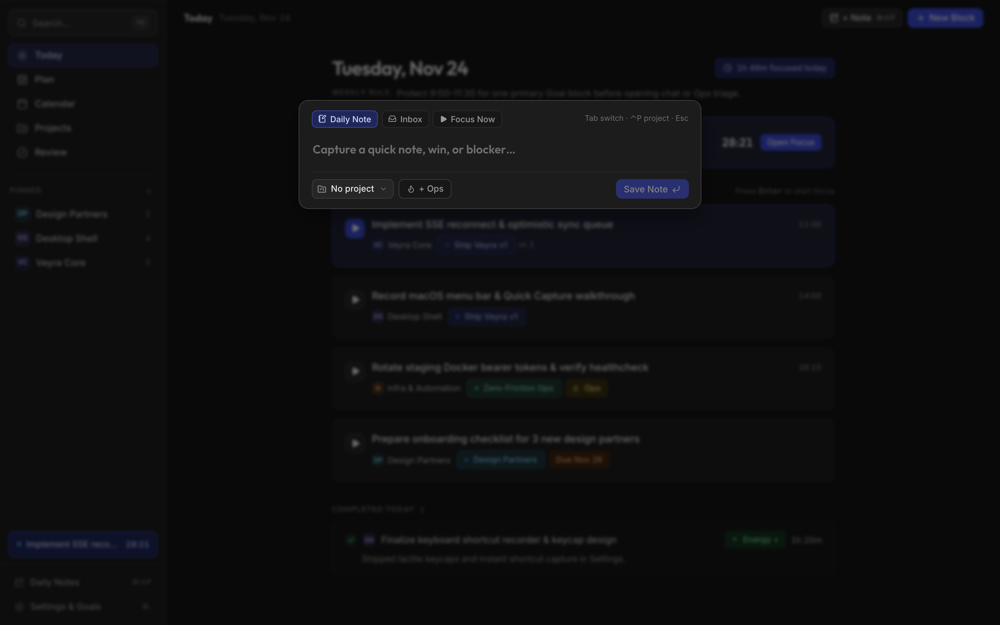
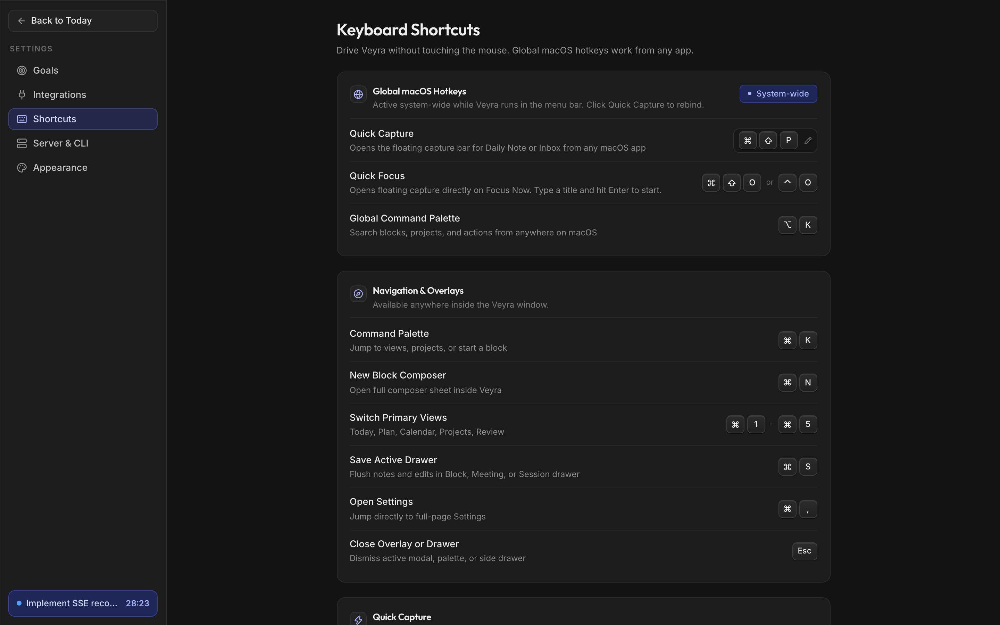

# Veyra

A calm, open-source focus and progress cockpit built for modern work across parallel projects and AI agents.

Veyra separates **thinking** from **execution**: use your AI coding environment (such as T3 Code or Claude Code) as the conversational planning and review interface via the `veyra` CLI (`--json`), while Veyra gives you a pure neutral dark macOS desktop and web cockpit that protects focus, measures real work with a count-up stopwatch, aligns blocks to overarching `Goals`, and surfaces recurring `Ops` drag in Weekly `Review`.



## Interface

<table>
  <tr>
    <td width="50%" valign="top">
      
      <br />
      <strong>Focus Mode</strong> — Count-up stopwatch with the backlog hidden and one-key controls (<code>P</code> pause, <code>C</code> complete, <code>N</code> notes).
    </td>
    <td width="50%" valign="top">
      
      <br />
      <strong>Plan &amp; Triage</strong> — Drag coarse blocks across the week alongside synced meetings, curated <code>Inbox</code>, and <code>Later</code> checkpoints.
    </td>
  </tr>
  <tr>
    <td width="50%" valign="top">
      
      <br />
      <strong>Calendar</strong> — Solid logged focus sessions next to synced calendar meetings and optional dashed <code>Planned</code> slots.
    </td>
    <td width="50%" valign="top">
      
      <br />
      <strong>Weekly Review</strong> — Goal alignment, build vs. <code>Ops</code> split, energy signals, daily notes, and recurring <code>Ops</code> automation radar.
    </td>
  </tr>
  <tr>
    <td width="50%" valign="top">
      
      <br />
      <strong>Global Quick Capture (<code>⌘⇧P</code>)</strong> — Floating capture bar from any macOS app for Daily Notes, Inbox items, or instant Focus Now.
    </td>
    <td width="50%" valign="top">
      
      <br />
      <strong>Keyboard Shortcuts</strong> — Full keyboard control with inline shortcut recording for the global macOS Quick Capture hotkey.
    </td>
  </tr>
</table>

## Core Principles

1. **Protect the brain:** Hide the backlog during active work and count time *up* like a stopwatch instead of down, so important tasks get the time they need to be done right.
2. **Single focus & intentional batching:** One active focus session at a time, with one-line pause breadcrumbs and clean retroactive session `trim` and `split`.
3. **Curated choice over debt:** No red "overdue" alarms for self-chosen dates. Unfinished scheduled blocks roll over quietly (`carryoverCount + 1`), recurring blocks vanish untouched with zero debt, and `Later` items carry explicit revisit checkpoints.
4. **Plan by day, measure actuals:** Drag coarse work blocks onto days in `Plan` without rigid clock-time timeblocking. Real meetings sync in as quiet context, while `Calendar` distinguishes solid `Done (logged)` sessions from optional dashed `Planned` slots.
5. **Progress over motion:** Link blocks and meetings to overarching `Goals`, flag reactive work orthogonally as `Ops`, and review real outcomes, energy signals, and recurring `Ops` patterns each week.

## Architecture

One TypeScript pnpm monorepo (`Node >= 22`):

- **`packages/core` (`@veyra/core`):** SQLite persistence (`better-sqlite3` + Drizzle ORM), sync-ready UUID/soft-delete/fractional-index model, single-focus and rollover invariants, calendar auto-matching, and browser-safe `@veyra/core/types`.
- **`packages/server` (`@veyra/server`):** Hono HTTP + SSE live-update server, optional bearer auth, Day-1 calendar sync runner (`ICS / CalDAV Feed` and local `Outlook CLI`), outgoing lifecycle webhooks (`focus.started`, `focus.ended`, `block.completed`), and Docker self-hosting.
- **`packages/cli` (`@veyra/cli`):** Full `veyra` CLI (`--json`) speaking strictly over the HTTP API, plus an agent skill in [`skills/veyra/SKILL.md`](skills/veyra/SKILL.md).
- **`packages/web` (`@veyra/web`):** React 19 + Vite + Tailwind CSS v4 cockpit (`Today`, `Focus`, `Plan`, `Calendar`, `Projects`, `Review`, Full-Page `Settings`, docked right-side drawers, universal right-click menus, and keyboard-first shortcuts).
- **`packages/desktop` (`@veyra/desktop`):** Native macOS Electron shell with embedded zero-config SQLite server (or remote Docker/VPS connection), menu bar tray, and system-wide floating Liquid Glass overlays (`⌘⇧P` Quick Capture, `⌘⇧O` / `⌃O` Focus Now, `⌥K` Command Palette).

## Quick Start

### Local macOS Desktop App (Zero-Config SQLite)

```bash
pnpm install
pnpm build
pnpm dev:desktop
```

Package a standalone `Veyra.app` and `.dmg` for macOS arm64:

```bash
pnpm package:mac
# Output: packages/desktop/release/mac-arm64/Veyra.app
```

### Self-Hosted Docker Server

```bash
export VEYRA_TOKEN="$(openssl rand -hex 24)"
docker compose up -d --build
curl -fsS http://127.0.0.1:4173/api/health
```

### `veyra` CLI

```bash
veyra config set --url http://127.0.0.1:4173
veyra today --json
veyra add "Audit webhook retries" --ops --date 2026-11-24 --json
veyra note add "Muting chat until 11:30 worked well" --json
veyra events sync --json
```

## Global Keyboard Shortcuts (macOS)

- **`⌘⇧P`** — Global Quick Capture (`Daily Note` / `Inbox` / `Focus Now`, works even when the main window is closed)
- **`⌘⇧O` / `⌃O`** — Global Quick Focus (opens directly on `Focus Now`; type a title and hit `Enter` to create and start focusing)
- **`⌥K`** — Global Command Palette
- **`Tab` / `⇧Tab`** — Cycle Quick Capture tabs (`⌃P` cycles project, `⌥O` toggles `Ops`)
- **`⌘1`–`⌘5`** — Switch between `Today`, `Plan`, `Calendar`, `Projects`, and `Review`
- **`⌘K` / `⌘N` / `⌘,` / `⌘S`** — In-app Command Palette, New Block, Settings, Save active drawer

## Documentation

- Product vision & principles: [`docs/VISION.md`](docs/VISION.md)
- Human guides (setup, commands, configuration, deployment, troubleshooting): [`docs/human/overview.md`](docs/human/overview.md)
- Canonical architecture, feature, interface & operations docs: [`docs/knowledge/README.md`](docs/knowledge/README.md)
- Agent routing manifest & open roadmap: [`docs/agent/manifest.json`](docs/agent/manifest.json) and [`docs/playbook/canvases/veyra/03_ecosystem_loop.md`](docs/playbook/canvases/veyra/03_ecosystem_loop.md)

## License

[MIT](LICENSE)
